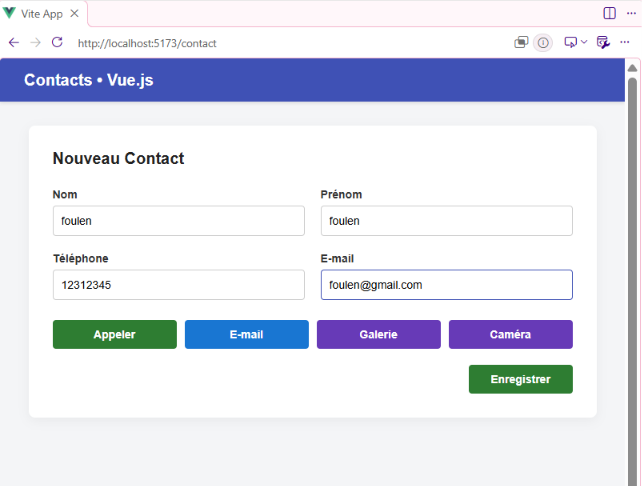
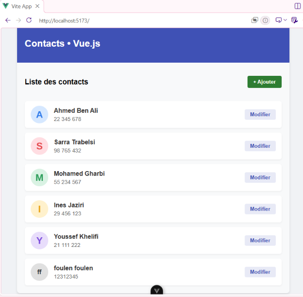
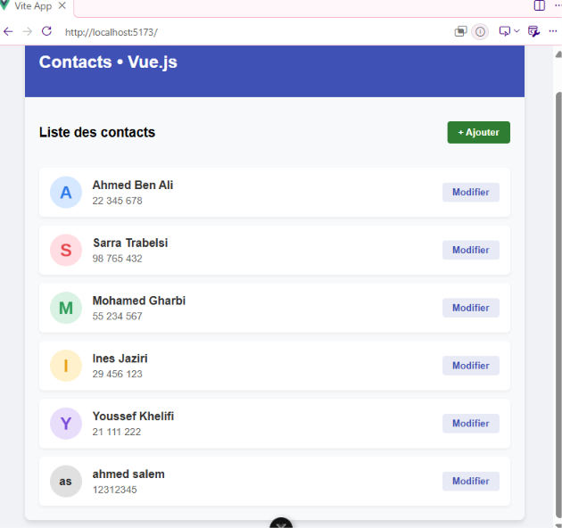

# TP Gestion des contacts

Ce projet consiste à créer une application Web avec Vue.js 3 . Elle permet d'administrer un carnet d'adresses complet grâce à une architecture en composants et une gestion centralisée des données.

# Instructions d'installation et d'exécution
1. Installer les dépendances du projet :
   npm install

2 . Lancer le serveur local :
   npm run dev

3. Ouvrir le projet :
   Cliquer sur le lien http://localhost:5173 dans le terminal pour voir le projet dans le navigateur.

# Scripts
- `npm run dev` : serveur de développement
- `npm run build` : version de production 

# Captures d'écran
![Les captures d'écran de l'application sont disponibles dans le dossier public/images]

![Capture 3 Modifier la nom et la prenom du contact foulen ]
(.public/images/cap3.png)

 
 # Auteur 
  Salem Nour Elhouda _ L2 DSI1 / G2